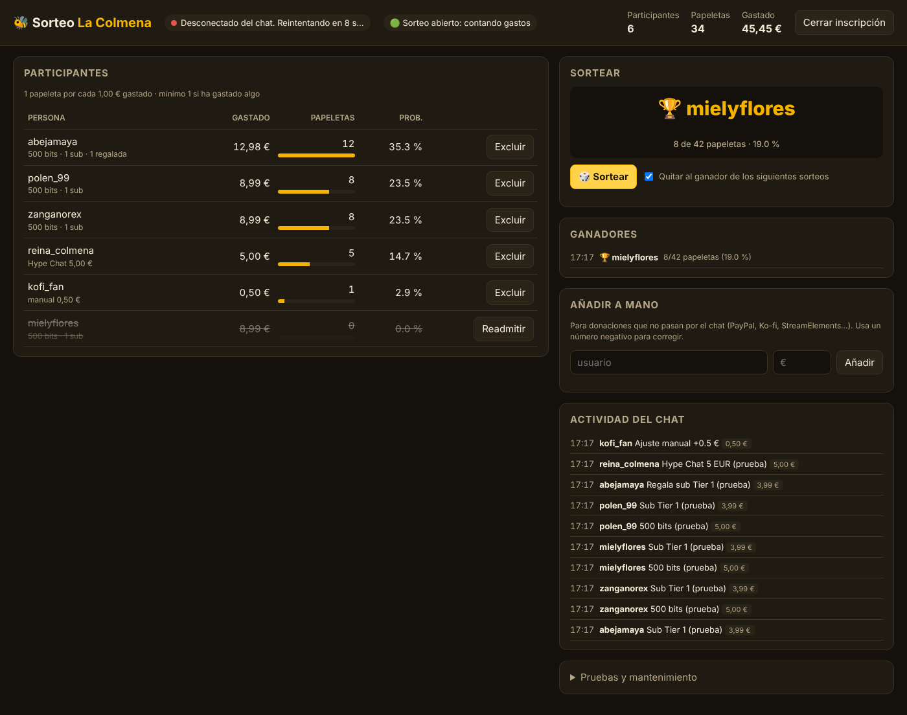
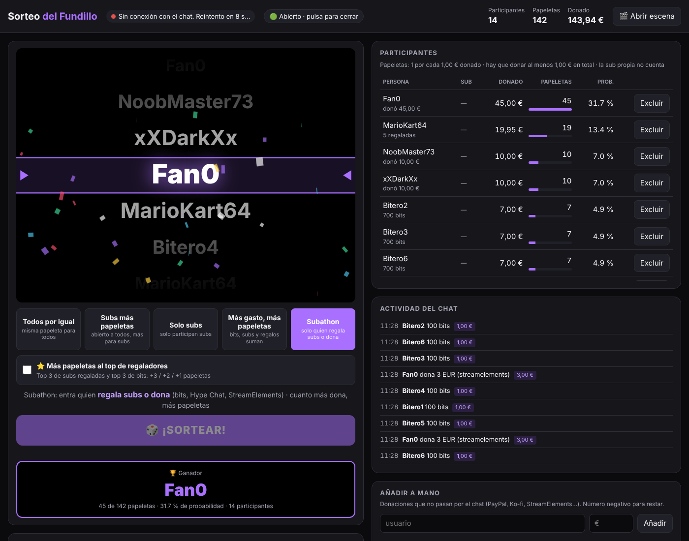
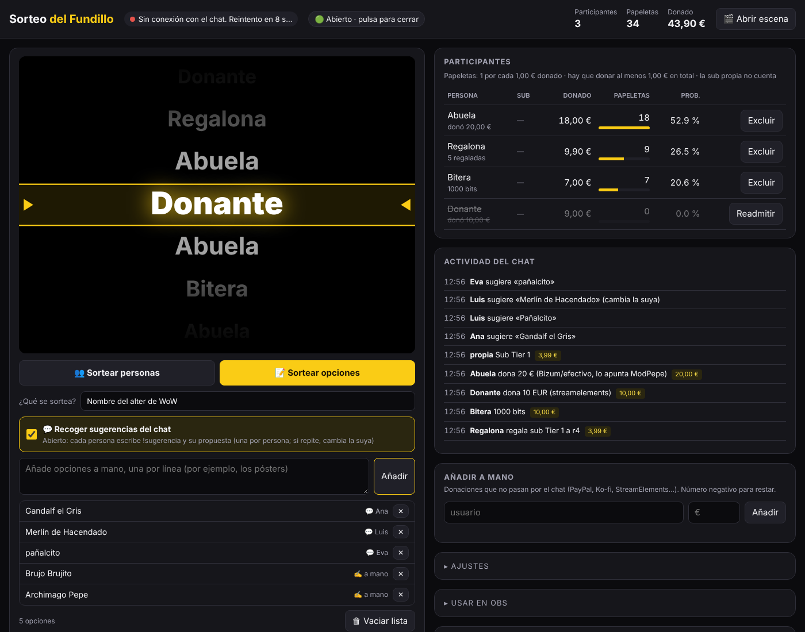
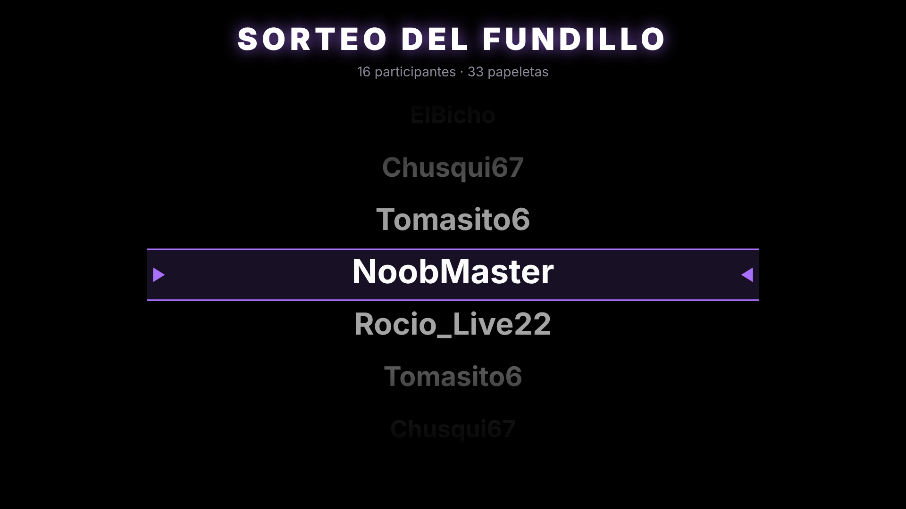
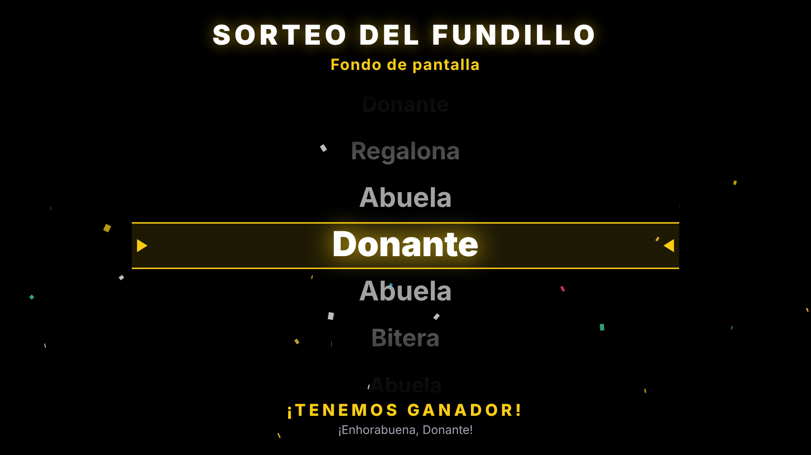

# Sorteo del Fundillo

Sorteos para directos de **Twitch** que funcionan **en el navegador**, sin instalar nada.

- La gente **entra escribiendo una palabra en el chat** (por defecto `!sorteo`).
- **Cuatro modos de sorteo** que se eligen con un botón: *Todos por igual*, *Subs más papeletas*, *Solo subs*
  y *Más gasto, más papeletas* (bits, subs, regalos y Hype Chat suman papeletas).
- El ganador sale con una animación sobre **fondo negro con los nombres cayendo de arriba abajo**, cada vez más
  despacio, hasta pararse en el ganador. Quien tiene más papeletas aparece más veces. Con sonido y confeti, lista para **OBS**.

## Modos de sorteo

Se eligen con los botones que hay encima de **¡SORTEAR!**. Puedes cambiar de modo en cualquier momento: las papeletas
se recalculan al instante y nadie desaparece de la lista.

| Modo | Quién participa | Papeletas (por defecto) |
|---|---|---|
| **Todos por igual** | Todo el que escriba `!sorteo` | 1 cada uno |
| **Subs más papeletas** | Todo el que escriba `!sorteo` | No sub 1 · Tier 1/Prime 2 · Tier 2 3 · Tier 3 4 |
| **Solo subs** | Solo suscriptores que escriban `!sorteo` | 1 cada uno |
| **Más gasto, más papeletas** | Todo el que escriba `!sorteo` | 1 + 1 por cada euro gastado (mínimo 1 si gasta algo) |
| **Subathon** | Solo quien regala subs o dona (bits, Hype Chat, StreamElements, `!donacion`, a mano). Escribir `!sorteo` o suscribirse uno mismo **no** cuenta | 1 por cada euro neto donado (hay que llegar al menos a 1 €) |

En todos los modos, quien gasta (bits, subs, regalos, Hype Chat) entra aunque no escriba la palabra (se puede desactivar).
Las papeletas de cada tier, el máximo por persona y el resto se cambian en **Ajustes**.

### Sortear opciones (hitos del subathon)

Arriba del panel eliges **👥 Sortear personas** o **📝 Sortear opciones**. Con opciones no se sortea gente, sino
propuestas: el póster, el nombre del alter, el disfraz…

- **A mano:** escribe opciones en el cuadro, una por línea, y pulsa *Añadir*.
- **Sugerencias del chat:** marca *💬 Recoger sugerencias del chat* y el chat propone con `!sugerencia texto`.
  Una por persona (si vuelve a escribir, cambia la suya) y sin repetidas. Quita las que no valgan con ✕.
- Las dos fuentes se juntan en la misma lista; *Vaciar lista* la deja limpia para el siguiente hito.
- Todas las opciones tienen la misma probabilidad. En OBS sale «¡Ha salido!» con la opción y quién la propuso.

**¿Qué se sortea?** es un texto (por ejemplo «Fondo de pantalla» o «Póster nuevo») que sale en OBS debajo de
«SORTEO DEL FUNDILLO» y queda apuntado en la lista de ganadores. Vale para los dos tipos de sorteo.

### Subathon y donaciones de StreamElements

En el modo **Subathon** entra en el sorteo quien regala subs o dona, y cuanto más dona, más papeletas tiene.
Por defecto se cuenta en **€ netos, igual que la barra del overlay del subathon**: sub regalada Tier 1 1,98 €,
Tier 2 3,96 €, Tier 3 9,91 €; de las donaciones cuenta el 90 %, de los bits el 70 % (100 bits = 0,70 €) y del
Hype Chat el 70 %. Lo añadido a mano en el panel cuenta tal cual. Todo se cambia en Ajustes, o se pasa a € brutos.

**Bizum y efectivo:** tú o un mod escribís en el chat `!donacion Nombre 5` (el mismo comando del overlay) y cuenta
como donación. Si lo escribe alguien que no es mod, no hace nada. Suscribirse uno mismo no cuenta. El mínimo para entrar (1 € por defecto)
y los euros por papeleta se cambian en Ajustes.

**Donaciones de StreamElements:** el programa lee el aviso que pone el bot de StreamElements en el chat cuando alguien
dona (por ejemplo `ElPepe just tipped €5.00`). Para que funcione:
1. En StreamElements, activa los avisos de donaciones (*tips*) en el chat del bot (*Chat bot → Chat alerts*).
2. En el panel, abre **Ajustes** y pega un aviso real de tu bot en **🧪 Prueba un aviso de donación**. Si sale
   ✔, está listo. Si sale ✖, escribe tu formato en «Formato del aviso» usando `{usuario}` y `{cantidad}`
   (por ejemplo `¡Gracias {usuario} por tus {cantidad}!`) y pulsa Guardar.

El nombre que cuenta es el que el donante escribe al donar en StreamElements: si no coincide con su usuario de Twitch,
aparecerá como otra persona. Lo puedes corregir con **Añadir a mano** (sumando a uno y restando al otro).

Mientras dure el subathon deja el panel abierto y el sorteo **abierto** (punto verde), o no contará lo que se done.
Puedes hacer varios sorteos seguidos: con «Quitar al ganador» marcado, quien gana no repite.

### ⭐ Extra para el top de regaladores

Debajo de los modos hay una casilla **«Más papeletas al top de regaladores»**. Si la marcas, los 3 que más subs han
regalado y los 3 que más bits han dado durante el sorteo reciben papeletas extra: **+3 al 1º, +2 al 2º y +1 al 3º**
(se cambia en Ajustes). Quien está en los dos tops suma los dos extras. Si hay empate, comparten puesto.
Funciona con cualquier modo, pero no mete a nadie que el modo deja fuera (en *Solo subs*, un regalador que no es sub
sigue sin participar). El panel muestra el top actual y una medalla junto a cada persona.

**Cómo sabe si alguien es sub y de qué tier:** por la insignia de sub que Twitch manda con cada mensaje del chat
(Tier 2 y Tier 3 llevan su propia numeración de insignia), y por los avisos de sub, resub y sub regalada que salen
durante el directo. Una sub regalada convierte en sub a quien la recibe. Los fundadores cuentan como Tier 1.

El dueño del canal no participa nunca.

En el modo **Más gasto, más papeletas**, cada cosa vale: bit 0,01 € · sub Tier 1 3,99 € · Tier 2 7,99 € ·
Tier 3 19,99 € · Prime 0 €. Las subs regaladas cuentan para quien regala. Los Hype Chats cuentan su importe en euros.
Ejemplo: escribe `!sorteo` y tira 500 bits → 1 + 5 = **6 papeletas**.

El ganador se elige con el generador aleatorio criptográfico del navegador, con probabilidad proporcional a las papeletas.

## Cómo usarlo

1. Abre `index.html` en Chrome, Edge o Firefox (doble clic vale), o la dirección donde lo tengas publicado (ver abajo).
2. En **Ajustes**, escribe el nombre de tu canal y pulsa **Guardar**. El punto de arriba se pone verde cuando ya lee el chat.
3. Durante el directo verás en vivo quién participa, sus papeletas y su probabilidad.
4. Pulsa **🎲 ¡SORTEAR!**. Los nombres empiezan a caer en el panel y en OBS a la vez.
5. En "Lo que escribe el último ganador" ves sus mensajes, para comprobar que está en el directo.

No hace falta cuenta, contraseña ni crear una app de Twitch: lee el chat como un espectador anónimo, y Twitch ya
anuncia en el chat los bits, subs y regalos.

Lo demás:
- **Abierto / Cerrado**: con el sorteo cerrado no entra nadie nuevo (para cerrar la inscripción antes de sortear).
- **Excluir / Readmitir** a cualquiera. Por defecto el ganador queda fuera de los siguientes sorteos (para varios premios).
- **Añadir a mano** euros a alguien (PayPal, Ko-fi, StreamElements…) o restarlos con un número negativo.
- **Pruebas**: botones para meter participantes falsos y ensayar. Pulsa **Reiniciar sorteo** antes del de verdad.
- **Exportar / Importar**: copia de seguridad del sorteo y los ajustes en un archivo.

Todo se guarda solo en tu navegador: si cierras la pestaña, al volver sigue donde estaba.

## En OBS

La escena (`escena.html`) es transparente y solo aparece (en negro) cuando sorteas. Para recibir la orden de sortear tiene que estar
**en el mismo navegador que el panel**:

**A · Todo dentro de OBS (recomendado)**
1. *Ver → Paneles → Paneles de navegador personalizados* → añade `index.html` (la dirección exacta aparece en el panel, en "Usar en OBS").
   Así manejas el sorteo desde OBS.
2. Añade una *Fuente de navegador* de 1920×1080 con `escena.html`, y marca *Controlar audio vía OBS* para el sonido.

**B · Captura de ventana**
Pulsa **🎬 Abrir escena** en el panel y captura esa ventana en OBS con *Captura de ventana* + filtro *Clave cromática*
(usa `escena.html?fondo=verde`).

Opciones de la escena, añadiéndolas a la dirección (y combinándolas con `&`):

| Opción | Qué hace |
|---|---|
| `?anuncio=1` | Barra "Escribe !sorteo para participar" mientras el sorteo está abierto |
| `?siempre=1` | El fondo negro con los nombres se ve siempre, no solo al sortear |
| `?segundos=20` | Segundos que se queda el ganador en pantalla (15 por defecto) |
| `?sonido=0` | Sin sonido |
| `?fondo=verde` | Fondo verde para clave cromática |

Ejemplo: `escena.html?anuncio=1&segundos=20`

En la escena no se muestra cuánta gente participa ni las papeletas de nadie; eso solo lo ves tú en el panel.

## Publicarlo con una dirección web (opcional)

Para tener una dirección fija (cómoda para OBS), se puede publicar gratis con GitHub Pages:
en el repositorio, *Settings → Pages → Deploy from a branch*, rama `main`, carpeta `/ (root)`.
Quedaría en `https://debenit0.github.io/lacolmena/sorteo/`.

## Cosas a tener en cuenta

- Solo cuenta lo que pasa **mientras el panel está abierto**: ábrelo antes de anunciar el sorteo.
- Las subs **regaladas de forma anónima** no cuentan (no se sabe quién las regala).
- Las donaciones de StreamElements/Streamlabs no pasan por el chat: añádelas a mano.
- Comprueba que tus sorteos cumplen las normas de Twitch y la ley de tu país sobre sorteos.

## Archivos

- `index.html`: panel · `escena.html`: escena para OBS
- `js/nucleo.js`: reglas del sorteo y lectura de mensajes de Twitch
- `js/chat.js`: conexión al chat · `js/rodillo.js`: animación de nombres, sonido y confeti · `js/enlace.js`: comunicación panel ↔ escena
- `test/`: tests (`npm test`, necesita Node.js; solo para desarrollo)
